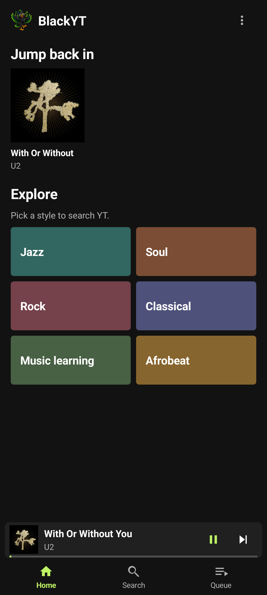
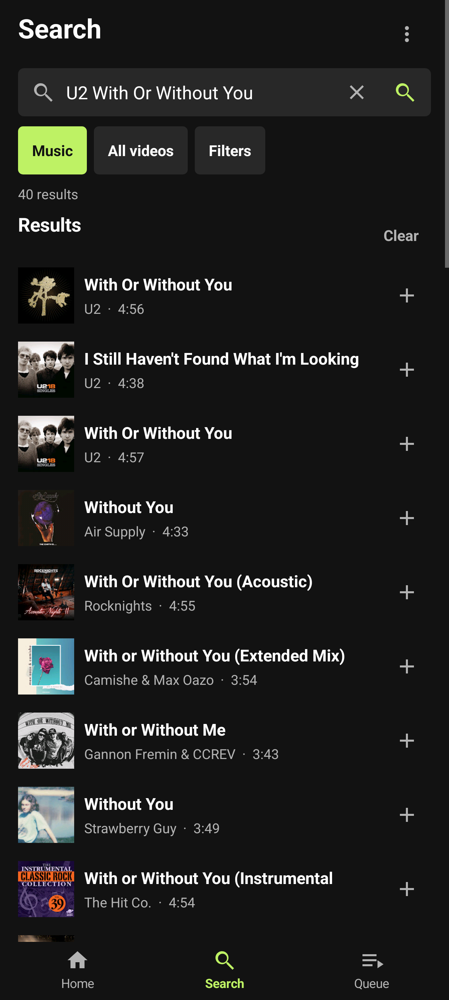
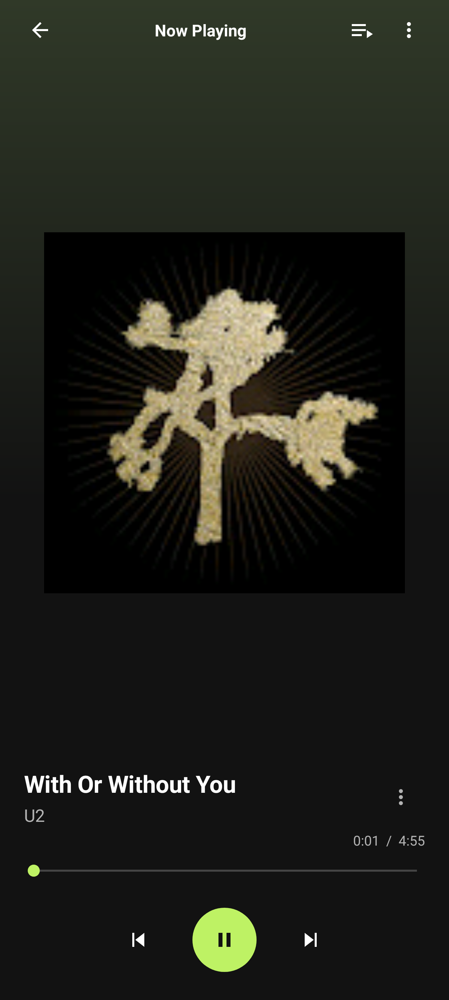

# BlackYT

**Android only (Android 8.0 or newer). An iOS app for iPhone and iPad is planned for later; no release date yet.**

BlackYT is an Android app for finding and playing YT music links. It extracts a stream URL on the phone and plays it through Android's media player.


## Install the native Android app

The native Android release is [v0.4.0](https://github.com/ezzye/BlackYT/releases/tag/v0.4.0), with **BlackYT-Android-v0.4.0.apk** (versionCode 40). Start with the detailed [Android installation guide](docs/INSTALL.md), or use the downloadable [offline HTML guide](android/docs/native-android.html). No GitHub sign-in, developer settings, USB debugging, Termux, or Mac is needed for normal installation. Android 8 or newer is required; automated v0.4.0 checks have run on a Pixel 10 Pro XL; other devices are unverified. See [FAQ](docs/FAQ.md), [troubleshooting](docs/TROUBLESHOOTING.md), and [android/README.md](android/README.md) for source builds and signing. The Android component is GPL-3.0-or-later; see [android/LICENSE](android/LICENSE) and [android/NOTICE](android/NOTICE).

## Daily use

BlackYT opens on **Home**, with bottom navigation for **Home**, **Search**, and **Queue**. Home has a small mascot, a **Jump back in** row of up to 12 recently played tracks, and colorful interest tiles. Each tile starts a real search for that interest. Recent-play history stores public track metadata and original artwork references locally; clear it using **Home → More (⋮) → Clear listening history**. BlackYT does not create fake playlists or fetch recommendations automatically.

Use the compact Search field and its action or keyboard Search/Enter key. Choose **Music** or **All videos** and open **Filters** for optional include-any and exclude-any terms. The last eight search phrases are stored locally and can be cleared. Use **Load more** for further results, up to 200 matches. Tapping a result starts it; **Add** appends it to the FIFO queue. Song thumbnails appear in results and playback surfaces when available.

A miniplayer appears above the bottom navigation only while a track is current. Tapping it opens the full **Now Playing** screen. Use Back to return; seek, Previous, Play/Pause, Next, Queue, and **More** are available there. More includes Stop and Retry. Queue items remain FIFO and can be removed; the queue lasts only for the current app session.

Music classification depends on YT metadata and is not guaranteed. BlackYT has no offline downloads or sign-in. It streams audio directly over HTTPS from YT's Googlevideo host; no BlackYT cloud relay is involved. YT may change its service and break extraction or playback.

## About BlackYT

BlackYT is an independent educational project. Its creator uses it to listen to songs they wrote and perform. The project aims to help students explore and learn about music regardless of socioeconomic circumstances, with fewer advertising interruptions and low running costs.

## Disclaimer

BlackYT is an independent, unofficial project for educational use. Use it lawfully, respect copyright, licences, creators' rights, and applicable platform terms. Educational status is not permission to break the law or bypass rights or restrictions. See [DISCLAIMER.md](DISCLAIMER.md) for the full notice.

## Current validation

v0.4.0 automated checks passed on the Pixel 10 Pro XL: nine unit tests in each build type, release lint with zero errors, live search/link/filter/paging/artwork checks, and the native Home/Search/Now Playing/history/queue controls. The exact signed release played silently for two minutes with the existing lock and display off, then moved automatically to the next queued song. Its installed APK hash matched the release file. The owner has not yet reviewed or listened to v0.4.0, and a fresh mobile-data check for this version has not been performed. Other phones are unverified. Historical v0.3.0 owner acceptance is separate. The Mac and Termux are not playback dependencies. See [verification details](android/docs/verification-v0.4.0.json).

## Legacy alternative: Termux + Chrome PWA (v0.2.0)

The earlier [v0.2.0 PWA release](https://github.com/ezzye/BlackYT/releases/tag/v0.2.0) is a separate two-part install: a Termux helper and a Chrome home-screen app labelled **BlackYT Phone**. It is not the native APK. Its setup and evidence are documented in the [legacy installation guide](docs/INSTALL.md). Choose it only if you need that older route; native Android is the primary install.

## Development

The Python web app remains available for local development. With Python 3:

```sh
./setup.sh
./start.sh
```

Then open <http://localhost:8765>. The [architecture notes](docs/ARCHITECTURE.md) describe the native app and legacy PWA data paths.

## Maintainer checks

```sh
.venv/bin/python -m unittest -v test_server test_phone_audio
.venv/bin/python phone/test_termux.py
cd android && ./gradlew assembleDebug testDebugUnitTest lintRelease
```

The release uses a signing key outside the repository. Keep a protected backup of that key; updates must use the same key. Never publish the key or commit it to Git. Future product work is tracked in [ROADMAP.md](ROADMAP.md).

## App preview

| Home | Search | Now Playing |
| --- | --- | --- |
|  |  |  |

App-only view renders from the Pixel; no system or lock-screen content is included. YT thumbnail artwork belongs to its respective rights holders. The navigation and player layout use [Spotify’s mobile Now Playing flow](https://support.spotify.com/mv-en/article/now-playing/) as a design reference while retaining BlackYT’s mascot and identity.
