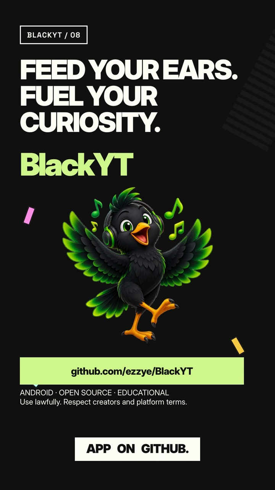
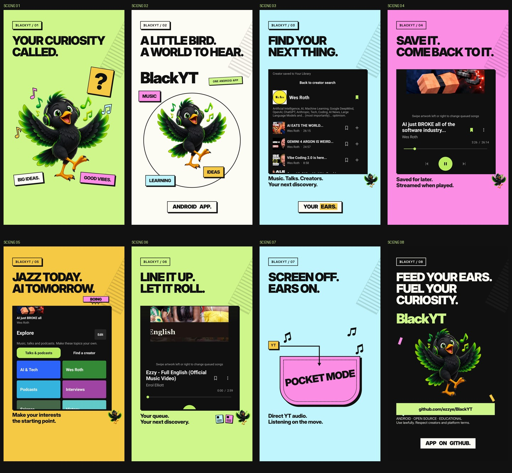
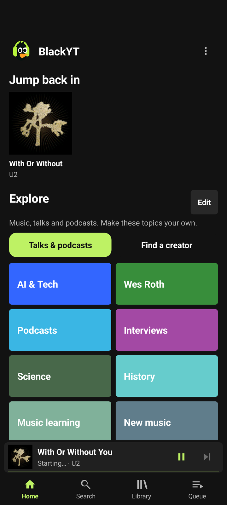
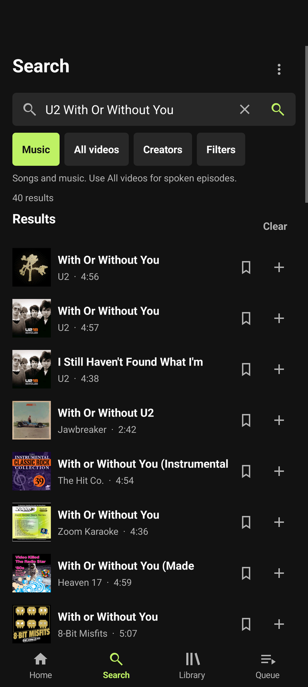
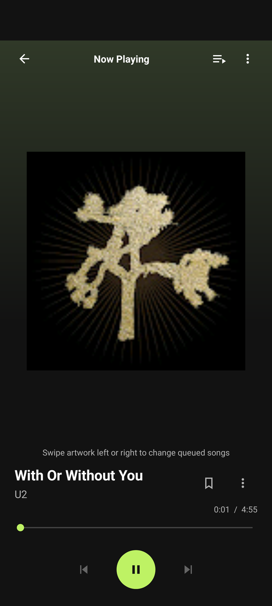
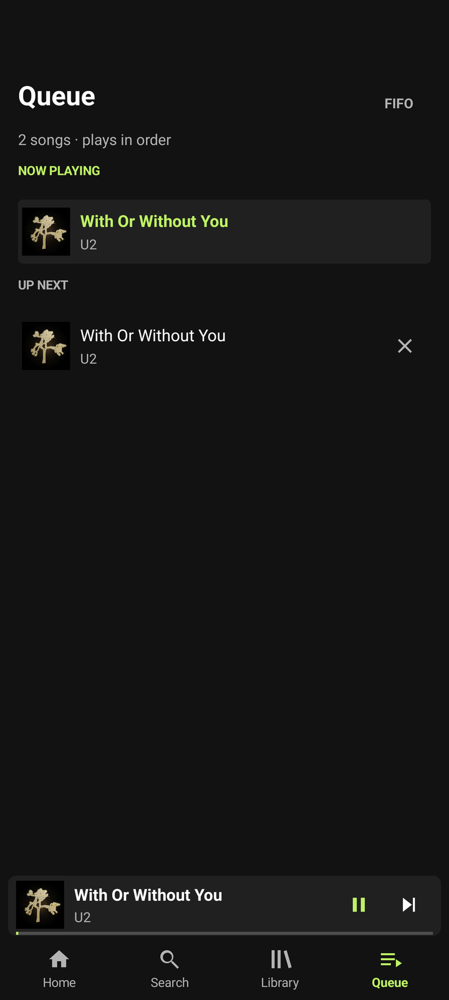
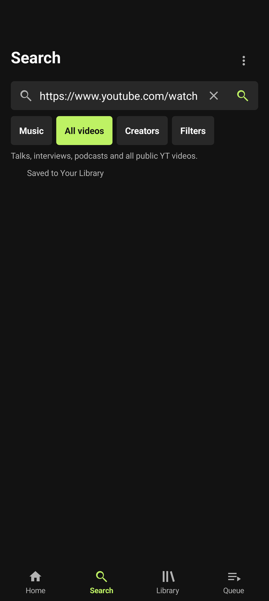

# BlackYT

**Android only (Android 8.0 or newer). An iOS app for iPhone and iPad is planned for later; no release date yet.**

BlackYT is an Android app for finding and playing music and spoken videos available through YT. It extracts a stream URL on the phone and plays it through Android's media player.


## Install the native Android app

The current native release is [v0.5.1](https://github.com/ezzye/BlackYT/releases/tag/v0.5.1), with **BlackYT-Android-v0.5.1.apk** (versionCode 51). Start with the detailed [Android installation guide](docs/INSTALL.md), or use the downloadable [offline HTML guide](https://github.com/ezzye/BlackYT/releases/download/v0.5.1/BlackYT-Android-Guide.html). No GitHub sign-in, developer settings, USB debugging, Termux, or Mac is needed for normal installation. Android 8 or newer is required. See [FAQ](docs/FAQ.md), [troubleshooting](docs/TROUBLESHOOTING.md), and [android/README.md](android/README.md) for source builds and signing. The Android component is GPL-3.0-or-later; see [android/LICENSE](android/LICENSE) and [android/NOTICE](android/NOTICE).

## v0.5.1: original audio

Videos with several language tracks now prefer the creator’s original audio when identified by YT. This fixes the Wes Roth episode selecting an Arabic dub instead of its English original. See the [audio comparison and explanation](android/docs/audio-comparison-v0.5.1.html) and [focused verification](android/docs/verification-v0.5.1.json). Direct streaming, background playback and the queue remain in place.

## Quick start: find spoken episodes

1. On **Home**, tap **Find a creator**. Enter a name such as **Wes Roth** and search in **Creators** mode. Open the creator to browse their actual Videos page; **Load more episodes** continues the list.
2. Tap the creator bookmark to save their page. Find it again under **Library → Saved creators**; tapping it fetches current videos. Use × in Library to remove a saved creator.
3. Tap an episode row to listen now. The bookmark saves it to **Library** for later; **+** adds it to the current queue. Tap a saved episode to resume, or use its ⋮ menu to play from the beginning or remove it.
4. To browse by interest, tap **Talks & podcasts**, or use **Home → Explore → Edit**. Add your own topic and search phrase. Leave **Music results only** off for talks and spoken episodes. Topics can be edited, moved or removed.
5. In the YT app, **Share → BlackYT** opens a preview. Short `youtu.be` links work, including supported starting times. Playback begins only when you choose the result. You can also paste the shared link into Search.

Library entries are links, metadata and listening progress, not offline audio. Install updates over the existing app: uninstalling or clearing app storage removes local saves and custom topics.

## Daily use

BlackYT has **Home**, **Search**, **Library**, and **Queue** tabs. Home includes **Jump back in** and editable Explore topics. Search offers **Music**, **All videos**, and **Creators**. All videos can find spoken episodes, talks, and interviews; creator pages show videos and support paging. You can share a supported YT link to BlackYT or open it from another app. BlackYT previews it without autoplay and preserves a supplied start time, including `youtu.be` share links. Save episodes and creators to the on-device Library; saved episodes retain listening progress, and saved creators fetch their latest videos when opened. Episodes with 30 seconds or less remaining resume from the beginning. This is YT video discovery, not a podcast directory: there is no RSS reader, subscription system, or automatic podcast classification. Library metadata and Explore edits stay on the phone; audio is streamed and is not available offline. Recent-play history stores public track metadata and original artwork references locally; clear it using **Home → More (⋮) → Clear listening history**.

Use the compact Search field and its action or keyboard Search/Enter key. Choose **Music** or **All videos** and open **Filters** for optional include-any and exclude-any terms. The last eight search phrases are stored locally and can be cleared. Use **Load more** for further results, up to 200 matches. Tapping a result starts it; **Add** appends it to the FIFO queue. Song thumbnails appear in results and playback surfaces when available.

A miniplayer appears above the bottom navigation only while a track is current. Tapping it opens the full **Now Playing** screen. Use Back to return; seek, Previous, Play/Pause, Next, Queue, and **More** are available there. More includes Stop and Retry. Track starts and button presses show immediate visual feedback. Swipe left or right across the artwork or miniplayer to move through the queue; short vertical drags do not change tracks. The queue is FIFO, does not wrap at either end, and lasts only for the current app session.

Music classification depends on YT metadata and is not guaranteed. BlackYT has no offline downloads or sign-in. It streams audio directly over HTTPS from YT's Googlevideo host; no BlackYT cloud relay is involved. YT may change its service and break extraction or playback.

## About BlackYT

BlackYT is an independent educational project. Its creator uses it to listen to songs they wrote and perform. The project aims to help students explore and learn about music regardless of socioeconomic circumstances, with fewer advertising interruptions and low running costs.

## Disclaimer

BlackYT is an independent, unofficial project for educational use. Use it lawfully, respect copyright, licences, creators' rights, and applicable platform terms. Educational status is not permission to break the law or bypass rights or restrictions. See [DISCLAIMER.md](DISCLAIMER.md) for the full notice.

## v0.5.0 device checks

The phone journey passed for Android Share with a `youtu.be` link and `t=205s`: BlackYT showed a preview without autoplay, then started at 205 seconds when selected. After saving the episode, recreating the Library activity retained the 205-second resume point. A Wes Roth creator search opened its Videos page, loaded another page, saved the creator, and reopened its latest videos from Library. Explore add/edit persisted, and the edited topic launched an All videos search. With the activity finished, Media3 playback continued with the screen locked and display off for 35 seconds; BlackYT was muted during this check. See [verification details](android/docs/verification-v0.5.0.json) for final automated results. Other devices and audible acceptance are not established by these checks.

## Legacy alternative: Termux + Chrome PWA (v0.2.0)

The earlier [v0.2.0 PWA release](https://github.com/ezzye/BlackYT/releases/tag/v0.2.0) is a separate two-part install: a Termux helper and a Chrome home-screen app labelled **BlackYT Phone**. It is not the native APK. Its setup and evidence are documented in the [legacy installation guide](docs/INSTALL.md). Choose it only if you need that older route; native Android is the primary install.

## Development

The Python web app remains available for local development. With Python 3:

```sh
./setup.sh
./start.sh
```

Then open <http://localhost:8765>. The [architecture notes](docs/ARCHITECTURE.md) describe the native app and legacy PWA data paths.

## Maintainer checks

```sh
.venv/bin/python -m unittest -v test_server test_phone_audio
.venv/bin/python phone/test_termux.py
cd android && ./gradlew assembleDebug testDebugUnitTest lintRelease
```

The release uses a signing key outside the repository. Keep a protected backup of that key; updates must use the same key. Never publish the key or commit it to Git. Future product work is tracked in [ROADMAP.md](ROADMAP.md).

## Watch BlackYT in one minute

[Watch or download the 60-second portrait promo](https://github.com/ezzye/BlackYT/releases/download/v0.5.1/BlackYT-Promo-60s-Portrait.mp4) · [Save the single-file offline video page](https://github.com/ezzye/BlackYT/releases/download/v0.5.1/BlackYT-promo.html) · [Caption text](docs/BlackYT-promo-captions.srt)

<a href="https://github.com/ezzye/BlackYT/releases/download/v0.5.1/BlackYT-Promo-60s-Portrait.mp4"></a>

The animated film shows real BlackYT v0.5.1 app footage: creator search and Videos, saving an episode and resuming it from Library, editing Explore, and the queue/artwork swipe. Screen-off listening is illustrated after a real player shot. Audio streams directly from YT; the app is Android only. The 1080×1920 MP4 has burned-in English captions and is about 14.5 MB. The standalone HTML embeds the film, works offline and can be saved and attached as a file; system sharing depends on the browser. It is a video companion, not an offline music-download feature.

The demonstration uses public example content and a staged Library. Device status/navigation chrome and other apps are excluded; no private listening history or raw phone recordings are published. The promo contains synthetic ElevenLabs Jamie narration and an original instrumental bed, with no third-party song or episode audio. See [production notes and credits](docs/PROMO.md).



## App preview

These v0.5.0 app-content renders show the native app with public example content.

| Home / Explore | Your Library |
| --- | --- |
|  |  |
| Find a creator | Browse a creator’s videos |
|  |  |
| Music search with artwork | Now Playing |
|  |  |
| Your queue | Shared links keep their starting point |
|  |  |
| Color icon | Themed icon |
|  |  |

App-only view renders from the Pixel’s installed v0.5.0 release; no system, lock-screen, private Library, personal listening history, or other-app content is included. Some own views were laid out while the display slept; these are interface renders, not full-device screenshots. YT thumbnail artwork belongs to its respective rights holders. The navigation and player layout use [Spotify’s mobile Now Playing flow](https://support.spotify.com/mv-en/article/now-playing/) as a design reference while retaining BlackYT’s mascot and identity.

Final v0.5.0 checks: **20 release unit tests and 14 phone instrumentation tests passed**; release lint had zero errors and 19 warnings. A complete 208.564-second song advanced naturally to the next queued track on mobile data. The full two-minute sample stayed locked/display asleep, and both conditions held at the next track. USB remained connected; playback was app-muted. See the versioned verification JSON for evidence and limits.
