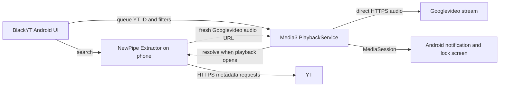

# BlackYT architecture

BlackYT now has a self-contained native Android app as its primary phone route. The v0.2.0 Termux and Chrome PWA remains available as a legacy alternative. These are separate implementations and their device results must be reported separately.

## Native Android app (primary)

The Java app uses NewPipe Extractor `v0.26.5` for on-device search, filtering, creator lookup, channel video pages, and stream extraction. Media3 `1.9.3` plays the selected progressive audio URL in an Android foreground media service with a native media session. Audio requests go directly from the phone to YT's Googlevideo host; BlackYT has no cloud relay or separate advertising layer. There is no sign-in. The v0.7.0 preview adds explicit temporary offline downloads. YT can change its service and break search, extraction, or playback.

Search offers **Music**, **All videos**, and **Creators**. Creator results open channel video pages with paging; users can save a creator. Music classification uses available YT metadata and is not guaranteed. Include words match if any supplied word occurs in the searchable title/channel text; exclude words remove a result when any supplied word occurs. **Play** starts a result; **Add** appends it to the FIFO queue. The queue remains in app memory for the current session. Android Share and Open intents accept supported YT links, including shared short links and start timestamps; an incoming link is previewed before the user chooses to play it. A local Library stores saved episode metadata and resume position, and saved creators. Episode progress within 30 seconds of the end restarts from the beginning. Saved creators fetch their latest videos when opened, so an internet connection is needed. Explore search tiles can be added, edited, moved, removed, or restored to defaults. Library and Explore data stay on the phone; they are not account-synced, and saved bookmarks contain no audio. Temporary downloads are stored separately in the v0.7.0 preview.

Android notification and lock-screen controls share the Media3 session. Code and build configuration for the single APK live in `android/`; the app label is **BlackYT**. The retired PWA launcher label was **BlackYT Phone**. The current native release is v0.5.0 (versionCode 50). The v0.5.0 phone journey passed Share/Open preview and timestamp handling, creator browsing and saving, Library resume, Explore editing, and screen-off playback with the activity finished. See the [v0.5.0 verification record](../android/docs/verification-v0.5.0.json) for final automated results. Screenshots may still depict v0.4.2 until refreshed.

## Native build and evidence

Twenty debug unit tests passed. The phone journey passed a shared `youtu.be` link with `t=205s`: BlackYT previewed without autoplay and started at 205 seconds after selection; Library retained the resume point after activity recreation. A Wes Roth creator search opened and paged the Videos page, saved the creator, then reopened its latest videos from Library. Explore add/edit persisted and the edited topic launched an All videos search. With the activity finished, Media3 playback continued muted for 35 seconds with the screen locked and display off. These checks do not establish audible acceptance or results on other phones. See [verification-v0.5.0.json](../android/docs/verification-v0.5.0.json) for final automated and release-unit results.

The project uses Java 17, Android SDK 36, Build Tools 35, Android Gradle Plugin 8.13.2, and Gradle 8.13. Build and signing guidance is in [`android/README.md`](../android/README.md). The native code is GPL-3.0-or-later; see [`android/LICENSE`](../android/LICENSE) and [`android/NOTICE`](../android/NOTICE). The NewPipe Extractor upstream version is [v0.26.5](https://github.com/TeamNewPipe/NewPipeExtractor/releases/tag/v0.26.5). Android documents Media3 service-based background playback in its [background playback guide](https://developer.android.com/media/media3/session/background-playback).

## v0.7.0 preview buffering and offline audio

`QueryRangeAudioDataSource` reads known-length, owned Googlevideo audio in consecutive 1 MiB query ranges. It resets the inner HTTP byte position to avoid double-skipping HTTP 200 responses, verifies every chunk length, detects early EOF, preserves caller ranges and uses direct transport when a reliable total length is absent. `RefreshingAudioDataSource` retains one 403 refresh allowance across open and read; later-chunk refresh resumes at the next unread byte and still checks format identity. The same query transport backs explicit downloads.

`PlaybackBufferPolicy` sets an 8-second startup and 15-second rebuffer reserve, with a 120–300-second time-prioritised buffer target. The service checks its reserve every two seconds and gives active playback priority over preparation and explicit downloads below 30 seconds. Prefix preparation remains connection-policy controlled and now stores up to 2 MiB per candidate in a 64 MiB LRU cache.

`OfflineAudioStore` queues explicit full-audio transfers serially into app-private files, checks Content-Length and the 256 MiB per-item / 512 MiB total limits, syncs and atomically renames a complete file, and commits an atomic metadata index. A 403 permits one fresh stream resolution only if selected format identity remains the same. It never persists signed stream URLs. Process interruption invalidates partial transfers. Ready files expire after 24 hours; expiry checks refuse and clean stale files. There are at most 100 entries. The process must stay alive for a transfer to finish; no persistent download service or job scheduler is claimed.

`OfflineFirstAudioDataSource` validates the same owned media ID and rules used by streaming, opens a complete unexpired local file before touching the streaming factory or resolver, and preserves byte positions for seeking. Missing or expired downloads use the normal streaming path. The production release’s signing key remains required for an in-place update; an isolated preview package permits testing without replacing the installed app.

## Legacy Termux + Chrome PWA (v0.2.0)

The legacy app uses a Python helper in Termux and a Chrome PWA. In phone mode, `server.py --phone --listen 127.0.0.1` resolves media and streams bounded HTTPS Googlevideo byte ranges through an opaque phone-loopback audio route. It has no cloud relay. The service worker caches only the app shell; audio is not available offline. The manual queue is page-session memory. The installed Chrome home-screen app was labelled **BlackYT Phone**.

The owner confirmed audible phone-local Prince playback, manual queue use, and two minutes of screen-locked playback for the legacy route. The locked queue transition was not separately confirmed. This is not evidence for the native APK. Legacy install and troubleshooting instructions remain in [`INSTALL.md`](INSTALL.md); the [v0.2.0 release](https://github.com/ezzye/BlackYT/releases/tag/v0.2.0) ships the portable PWA/Termux bundle, not a single-app APK.

The Mac development mode still serves the PWA at `http://localhost:8765`. It is a development path, not a playback dependency of the native APK.

### Temporary stream refusals

The native DataSource keeps the app-owned item and byte-range request while resolving a Googlevideo address. On HTTP 403 only, it closes the failed connection, requests a fresh stream address, and retries that open once. Repeated refusals and other HTTP statuses remain errors. This uses the same direct phone-to-YT route and does not add a relay or change content restrictions. Saved Library metadata never contains signed stream addresses.
