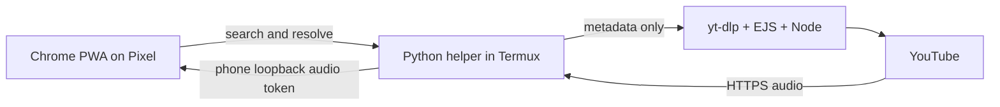

# Architecture and the one-app path

## Current phone version

`server.py --phone --listen 127.0.0.1` binds only to phone loopback. The Mac development mode keeps its separate direct-browser streaming behavior. In phone mode, `/api/resolve` replaces the signed YouTube URL with a short-lived opaque `/api/audio/<token>` route. The helper requests the audio over normal verified HTTPS and streams bounded chunks to the same phone's browser. Byte-range requests and seeking are supported. Every media URL and redirect is restricted to HTTPS Googlevideo hosts; there is no arbitrary-URL proxy API.

The phone adapter exists because the physical Pixel's direct browser request for Prince returned HTTP 403, while native Termux HTTPS requests returned valid audio. The local adapter then played that track, confirmed by player time advancing and owner listening. This evidence supports the current route; it does not establish one universal reason for every YouTube 403.

The service worker caches the application shell only. Search and API replies, signed media addresses, and audio are not stored for offline listening. Preferences are Chrome local storage; the queue is page-session memory. `phone/blackyt.sh` owns its server process, waits for the expected status identity, opens the browser, and keeps a Termux wake lock until exit. Android may still stop Termux.

## Distribution

The portable release contains an original-code runtime archive, a hash-pinned installer, a setup script and offline guide. `setup-phone.sh` verifies the installer, then calls its explicit `--local` mode. The installer verifies the archive and checks extraction paths before atomically selecting a managed release under `~/blackyt/releases`. Dependencies are installed separately from their normal sources. Download the private release through signed-in Chrome; no GitHub token is needed by Termux.

`phone/package_release.py` builds in a temporary destination, so it does not overwrite the developer's LAN transfer guide. The alternative `phone/build_phone.py` generates the one-time Mac transfer flow. Both routes use the same runtime whitelist. No GitHub Actions workflow is automatically enabled by this project.

## One icon versus one installed application

| Route | Requirements | Status |
| --- | --- | --- |
| Termux + Chrome PWA | Start `blackyt`, then use the PWA | Implemented; physical playback, manual queue and two-minute screen lock confirmed |
| Launcher APK | Still installs Termux and Chrome; uses a controlled external command | Proposed only; not a single-app runtime |
| Self-contained Android APK | Resolver and player inside BlackYT's process/service lifecycle | Recommended next development stage; not built |

A small launcher can use Termux's [RUN_COMMAND intent](https://github.com/termux/termux-app/wiki/RUN_COMMAND-Intent), but requires the owner to grant its command permission and enable external commands. It reduces taps while retaining the Termux dependency. Do not grant general command access to an untrusted launcher.

A [Trusted Web Activity](https://developer.android.com/develop/ui/views/layout/webapps/trusted-web-activities) displays web content using the browser. It does not automatically include Python, Node, yt-dlp or the phone helper. That is why a plain PWA wrapper is insufficient here.

## Recommended single-APK work packages

This is a proposed design based on Android's documented components, not a tested native implementation:

1. Build an Android app in Kotlin. Keep the current HTML/CSS interface through [WebViewAssetLoader](https://developer.android.com/develop/ui/views/layout/webapps/load-local-content) if useful, or rebuild the interface natively. Route explicit search/play/queue actions through a narrow application interface.
2. Place player and media session in [Media3 MediaSessionService](https://developer.android.com/media/media3/session/background-playback). Let that service own playback, audio focus, notifications, lock-screen controls and the queue. A hidden WebView should not own long-running playback.
3. Evaluate [NewPipeExtractor](https://github.com/TeamNewPipe/NewPipeExtractor) as the native extraction layer. Re-test the same tracks, filters, source-host checks and network changes. Alternatively, prototype embedding Python and a supported JavaScript runtime; this preserves more current backend code but adds runtime packaging and maintenance. Neither route is established by the present PWA tests.
4. Persist queue/preferences deliberately; refresh expiring media links; handle phone calls, headset changes, loss of network and restarts. Keep all YouTube requests on the phone.
5. Test screen lock, a queue transition while locked, mobile-data playback without any Mac connection, low battery/background restrictions and recovery on the actual Pixel.
6. Deliver a signed APK, source/build instructions, dependency notices and a tested update path. Choose the project's licence before including GPL-covered upstream code.

Termux is [GPLv3](https://github.com/termux/termux-app/blob/master/LICENSE.md); NewPipeExtractor includes its own GPL licence. Their source is not silently re-licensed by BlackYT. The current repository inspected those projects but did not copy their application/extractor code. A native port has a separate dependency and distribution review before release.

## Verification boundary

The owner confirmed phone-local audio, manual queueing and two minutes with the screen locked. A locked queue transition and the exact mobile-data/USB-disconnected conditions were not separately restated. The new portable ZIP has automated package and mocked installer checks; its fresh-phone setup has not been repeated physically. No one-app APK exists in this repository.
