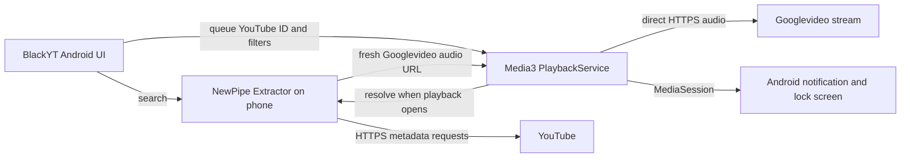

# BlackYT architecture

BlackYT now has a self-contained native Android app as its primary phone route. The v0.2.0 Termux and Chrome PWA remains available as a legacy alternative. These are separate implementations and their device results must be reported separately.

## Native Android app (primary)

The Java app uses NewPipe Extractor `v0.26.5` for on-device search, filtering, and stream extraction. Media3 `1.9.3` plays the selected progressive audio URL in an Android foreground media service with a native media session. Audio requests go directly from the phone to YouTube's Googlevideo host; BlackYT has no cloud relay or separate advertising layer. There is no sign-in or offline audio download. YouTube can change its service and break search, extraction, or playback.

The screen has a search box, **Music results only** checkbox, comma-separated include and exclude word fields, result actions, player controls, and a session queue. Search results and filter matching use available YouTube metadata; the music classification is not guaranteed. Include words match if any supplied word occurs in the searchable title/channel text. Exclude words remove a result when any supplied word occurs. **Play** starts a result now; **Add** appends it to the FIFO queue. The queue is held in current app memory; filter settings persist. Retry extracts a fresh URL after a network change or expired stream. No external Open or Share intent is implemented; users paste links into the search field.

Android notification and lock-screen controls share the Media3 session. Code and build configuration for the single APK live in `android/`; the app label is **BlackYT**. The retired PWA launcher label was **BlackYT Phone**. The private native preview is [v0.3.0-native](https://github.com/ezzye/BlackYT/releases/tag/v0.3.0-native), asset `BlackYT-Android-v0.3.0.apk`. The exact device results and limits are recorded below.

## Native build and evidence

The project uses Java 17, Android SDK 36, Build Tools 35, Android Gradle Plugin 8.13.2, and Gradle 8.13. The signed native release builds and is installed on the Pixel 10 Pro XL; its installed APK hash matches the release file. Five unit checks pass, and release lint reports zero errors with routine warnings. Direct native Googlevideo audio returned HTTP 200. The owner confirmed audible native playback, continued playback with the screen locked, and automatic playback of the next queued song while locked. Those owner checks used the pre-release build; the final signed release has the same playback engine. A fresh-song check on mobile data with USB disconnected is pending owner confirmation.

Build and installation details, signing backup guidance, and recovery steps are in [`android/README.md`](../android/README.md) and the [native Android guide](../android/docs/native-android.html). The native code is GPL-3.0-or-later; see [`android/LICENSE`](../android/LICENSE) and [`android/NOTICE`](../android/NOTICE). The NewPipe Extractor upstream version is [v0.26.5](https://github.com/TeamNewPipe/NewPipeExtractor/releases/tag/v0.26.5). Android documents Media3 service-based background playback in its [background playback guide](https://developer.android.com/media/media3/session/background-playback).

## Legacy Termux + Chrome PWA (v0.2.0)

The legacy app uses a Python helper in Termux and a Chrome PWA. In phone mode, `server.py --phone --listen 127.0.0.1` resolves media and streams bounded HTTPS Googlevideo byte ranges through an opaque phone-loopback audio route. It has no cloud relay. The service worker caches only the app shell; audio is not available offline. The manual queue is page-session memory. The installed Chrome home-screen app was labelled **BlackYT Phone**.

The owner confirmed audible phone-local Prince playback, manual queue use, and two minutes of screen-locked playback for the legacy route. The locked queue transition was not separately confirmed. This is not evidence for the native APK. Legacy install and troubleshooting instructions remain in [`INSTALL.md`](INSTALL.md); the [v0.2.0 release](https://github.com/ezzye/BlackYT/releases/tag/v0.2.0) ships the portable PWA/Termux bundle, not a single-app APK.

The Mac development mode still serves the PWA at `http://localhost:8765`. It is a development path, not a playback dependency of the native APK.
